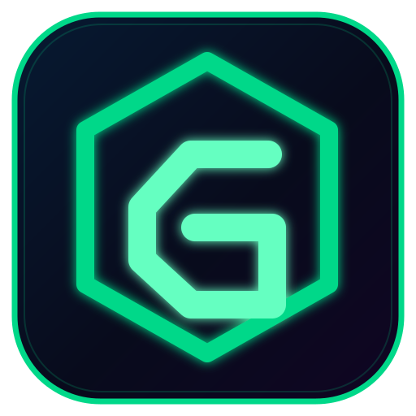

<p align="center">
  
</p>

# Golden Compass Navigator

A fintech application prototype focused on investment workflows and market analysis, with portfolio tools, market charts, and account-management interfaces.

## Highlights

- Portfolio and market dashboards
- Interactive candlestick charting
- Watchlists and market information
- Order-history and brokerage-account interfaces
- Investment and account workflows

## Technology

- React 19 and TypeScript
- TanStack Start and TanStack Router
- Vite and Nitro
- Supabase
- Drizzle ORM and PostgreSQL
- Lightweight Charts
- Tailwind CSS

## Getting Started

Requirements: Node.js and npm.

```bash
git clone https://github.com/XTAsync/Gcrepo.git
cd Gcrepo
npm install
npm run dev
```

## Available Scripts

```bash
npm run build
npm run lint
npm run format
npm run preview
```

## Configuration

Add the service configuration required by the application to your local environment. Never commit API keys, database credentials, or other secrets.

## Project Status

A development prototype. Do not interpret interface components as proof of live market-data coverage, brokerage connectivity, or real-money trading availability.
